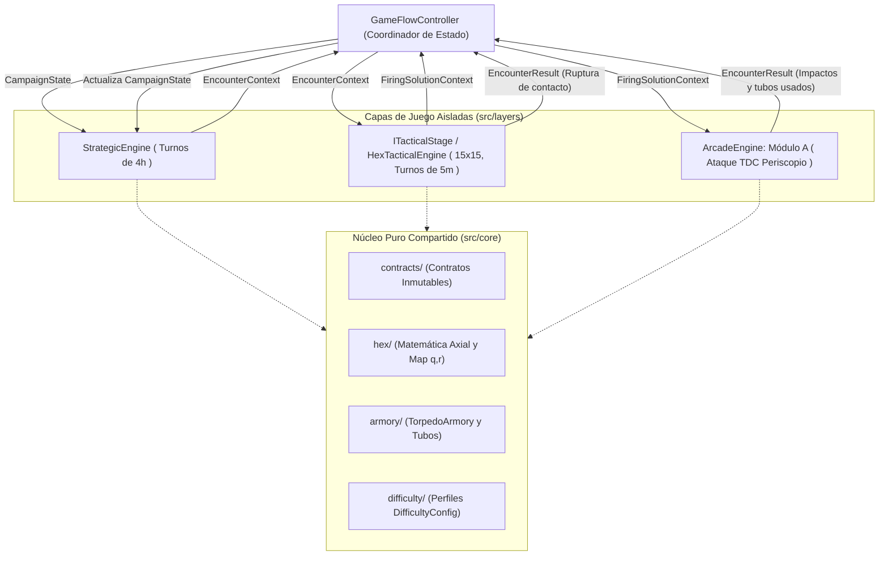

# ARQUITECTURA DEL SISTEMA: SUBMARINE COMMAND

## 1. Principios Arquitectónicos Innegociables

1. **Separación Estricta Dominio vs. Vista:** Toda la lógica matemática, reglas tácticas, gestión de recursos y máquinas de estado residen en módulos puros de TypeScript sin dependencias del DOM ni de `CanvasRenderingContext2D`.
2. **Desacoplamiento Total de las 3 Capas:** Las capas `StrategicLayer`, `TacticalLayer` y `ArcadeLayer` tienen prohibido importarse entre sí o mutar el estado de otra capa. Toda transición ocurre a través de `GameFlowController` mediante contratos de datos inmutables (`readonly`).
3. **Diseño Multi-Teatro Basado en Datos:** Ninguna facción, mapa o catálogo de buques se codifica a fuego en las reglas; la campaña se alimenta de un `TheaterDefinition`.
4. **Cero Bucles Anidados (`Zero Nested Loops`):** Prohibido anidar iteraciones (`for`, `while`, `.forEach`, `.map`) dentro de una misma función. Las consultas espaciales utilizan indexación `O(1)` mediante `Map<HexKey, HexCell>` con claves axiales `"q,r"` y funciones semánticas de un único nivel de iteración.
5. **Alta Cohesión y Tamaño Acotado:** Una única responsabilidad por función (~15-25 líneas orientativas) y por archivo (límite estricto < 200 líneas).

---

## 2. Flujo Entre Capas y Contratos de Transición



---

## 3. Estructura de Directorios (Estado tras Hito 1.3)

```text
/
├── AGENTS.md                             # Reglas de ingeniería activas automáticamente en cada sesión
├── CHANGELOG.md                          # Historial cronológico inverso (Keep a Changelog)
├── docs/
│   ├── ARCHITECTURE.md                   # Mapa modular, contratos y diagramas de flujo
│   ├── GAME_DESIGN.md                    # Fórmulas matemáticas y reglas mecánicas cerradas
│   ├── GAME_DESIGN_VISION.md             # Visión general y roadmap de las 6 fases
│   ├── STATUS.md                         # Estado vivo del proyecto para handoff inmediato
│   └── phases/
│       └── PHASE_01_VERTICAL_SLICE.md    # Especificación funcional de la Fase 1
├── src/
│   ├── core/                             # Lógica de dominio pura compartida (Hito 1.1 completado)
│   │   ├── contracts/                    # Contratos inmutables e interfaces de transición
│   │   ├── difficulty/                   # Tabla de perfiles EASY, NORMAL, HARD
│   │   ├── armory/                       # Máquina de estados de tubos y reserva de torpedos
│   │   └── hex/                          # Geometría axial (q, r) e índice Map<string, HexCell>
│   ├── layers/
│   │   ├── strategic/                    # Capa Estratégica 12x8 (Hito 1.2 completado)
│   │   │   ├── domain/                   # Escenario Atlántico, abanico 0/1/2 hex, energía e intercepción
│   │   │   └── view/                     # Carta náutica Canvas 2D, unidades, HUD e input handler
│   │   ├── tactical/                     # Capa Táctica 15x15 tras ITacticalStage (Hito 1.3 completado)
│   │   │   ├── domain/                   # Cotas, alcance 0..3 hex, geometría AOB/banda y HexTacticalEngine
│   │   │   └── view/                     # Plotter 15x15, anillo de tiro 1..4 hex, HUD y periscopio
│   │   └── arcade-torpedo/               # Periscopio, TDC y física de espoletas (pendiente: Hito 1.4)
│   ├── flow/                             # GameFlowController y stub de FiringSolutionContext (Hito 1.3)
│   └── main.ts                           # Arranque Canvas 2D conectado a las 3 fases de GameFlowController
└── tests/
    ├── core/                             # Tests unitarios de dominio nuclear (hex y armory)
    ├── layers/
    │   ├── strategic/                    # Tests unitarios de navegación, energía y motor estratégico
    │   └── tactical/                     # Tests unitarios de movimiento táctico, geometría AOB y motor 15x15
    └── flow/                             # Tests unitarios de transición entre capas en GameFlowController
```

---

## 4. Contratos Globales de Datos (`src/core/contracts/`)

| Contrato | Responsabilidad en la Arquitectura |
| :--- | :--- |
| `DifficultyConfig` | Parametriza reserva infinita/finita, turnos de recarga, penalización acústica, tolerancia de espoleta, probabilidad de *dud* e incertidumbre estratégica. |
| `TorpedoArmoryState` | Modela individualmente `bowTubes`, `sternTubes` y `reserveTorpedoes`. Cada tubo gestiona su estado (`LOADED`, `RELOADING`, `EMPTY`, `DAMAGED`), turnos restantes y pausa silenciosa (`isReloadPaused`). |
| `TheaterDefinition` | Define de forma declarativa el teatro de operaciones, dimensiones del mapa, bases navales y catálogos `SubmarineSpec` y `SurfaceShipSpec`. |
| `SubmarineState` | Posición axial, rumbo, postura (`SURFACED` / `SUBMERGED`), cota, combustible, baterías, integridad del casco y `TorpedoArmoryState`. |
| `CampaignState` | Estado raíz de la patrulla activa: teatro cargado, turno global, dificultad, estado del submarino, contactos móviles y tonelaje hundido. |
| `EncounterContext` | Fotografía inmutable enviada desde `StrategicLayer` hacia `ITacticalStage` al interceptar un contacto. |
| `FiringSolutionContext` | Fotografía geométrica (distancia relativa real, AOB real, buque objetivo y armería) enviada hacia `ArcadeLayer` al subir el periscopio. |
| `EncounterResult` | Resultado inmutable devuelto a `StrategicLayer` (armería actualizada, daño sufrido, hundimiento del blanco, tonelaje y tiempo consumido). |
| `ITacticalStage` | Contrato polimórfico que aísla la implementación del tablero táctico (hexagonal 15x15 vs. futuro ploteo polar por anillos). |

---

## 5. Modelo Matemático Hexagonal (`src/core/hex/`)

- **Sistema de Coordenadas:** Axial `(q, r)` con tercera coordenada cúbica implícita `s = -q - r` (`q + r + s = 0`), óptimo para distancias exactas en `O(1)` y trazado de anillos sin trigonometría costosa.
- **Orientación Base:** `POINTY_TOP` por defecto (configurable en `HexLayout`), alineando los rumbos náuticos con los seis lados del hexágono.
- **Indexación Espacial:** Todo tablero se almacena en `HexGridMap<TCell>` sobre un `ReadonlyMap<HexKey, TCell>` indexado por la clave canónica `"q,r"`, evitando matrices bidimensionales `grid[x][y]` y garantizando búsquedas directas libres de bucles anidados.
